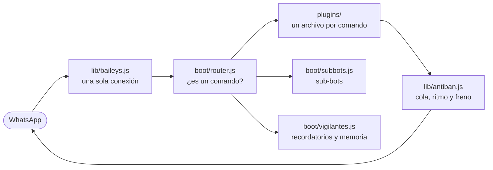

<div align="center">

<picture>
  <source media="(prefers-color-scheme: dark)" srcset="docs/assets/portada-oscura.svg">
  
</picture>

<br>

<a href="#comprobado"><picture>
  <source media="(prefers-color-scheme: dark)" srcset="docs/assets/insignia-pruebas-oscura.svg">
  
</picture></a>
<a href="#el-menu"><picture>
  <source media="(prefers-color-scheme: dark)" srcset="docs/assets/insignia-comandos-oscura.svg">
  
</picture></a>
<a href="#licencia-y-marca"><picture>
  <source media="(prefers-color-scheme: dark)" srcset="docs/assets/insignia-licencia-oscura.svg">
  
</picture></a>
<a href="#instalacion"><picture>
  <source media="(prefers-color-scheme: dark)" srcset="docs/assets/insignia-node-oscura.svg">
  
</picture></a>

[](https://github.com/SergioOficial/ado-bot/actions/workflows/test.yml)

**El bot de WhatsApp modular, sin cajas negras.**
Se conecta con Baileys, arranca con un código de vinculación y cada comando es un
archivo que puedes leer, cambiar o borrar.

[Estado](#estado) · [Instalación](#instalacion) · [El menú](#el-menu) ·
[Comprobado](#comprobado) · [Estructura](#estructura-del-proyecto) ·
[Últimos cambios](#ultimos-cambios) · [Colaboradores](#colaboradores) ·
[Licencia](#licencia-y-marca)

</div>

<picture>
  <source media="(prefers-color-scheme: dark)" srcset="docs/assets/cifras-oscura.svg">
  
</picture>

<picture>
  <source media="(prefers-color-scheme: dark)" srcset="docs/assets/divisor-oscura.svg">
  
</picture>

<h2 id="lo-que-lo-hace-distinto">Lo que lo hace distinto</h2>

No es una lista de deseos: cada línea de abajo tiene su archivo, y su prueba.

| Lo que promete | Dónde está para leerlo |
|---|---|
| un anti-ban con cola de envíos, ritmo y calentamiento, y metadatos que varían sin tocar lo que se lee | `lib/antiban.js` y `lib/metadatos.js` |
| si un comando revienta, los demás siguen funcionando | `boot/router.js` |
| el menú sale de los plugins que hay en el disco, no de una lista escrita a mano | `plugins/info/menu.js` y `lib/menu-ayuda.js` |
| la sesión aguanta cortes y reinicios | `lib/baileys.js` y `boot/arranque.js` |
| cada afirmación de este README tiene su prueba | `pruebas/`, todas en verde |
| los números de esta página no están escritos a mano | `scripts/readme-stats.mjs` y `scripts/arte.mjs` |

_Reducir el riesgo no es eliminarlo: eso lo decide WhatsApp. Lo que sí está en
nuestra mano está contado en [el anti-ban](docs/ANTIBAN.md), con su informe al lado._

<picture>
  <source media="(prefers-color-scheme: dark)" srcset="docs/assets/divisor-oscura.svg">
  
</picture>

<h2 id="instalacion">⚡ Instalación en un comando</h2>

```bash
bash <(curl -fsSL https://raw.githubusercontent.com/SergioOficial/ado-bot/main/instalar.sh)
```

Descarga el bot, instala las dependencias, deja un `.env` listo, comprueba que
todo carga y **arranca**. Y al terminar deja un comando `ado` en el PATH, así
que la próxima vez no hace falta acordarse de la carpeta ni escribir `cd`:

```bash
ado            # arrancar
ado update     # actualizar y arrancar
ado verify     # comprobar que todo carga, sin abrir WhatsApp
ado repair     # reinstalar dependencias y comprobar
ado dir        # ¿dónde está instalado?
```

Si prefieres que **no** arranque nada (un servidor, un script, una instalación
para mirar): `--sin-arrancar`.

<details>
<summary><strong>📱 Qué pasa en el primer arranque</strong> — el código se queda en pantalla</summary>

1. Si todavía no hay sesión, **no se pinta el cartel del bot**: la terminal se
   queda con texto llano, porque el cartel limpia la pantalla y se llevaría por
   delante el código.
2. Te pide el número (o toma `WHATSAPP_NUMBER`) y pide el código de vinculación.
3. El código sale **en texto plano**, con el número al lado y sin redibujar
   nada. Se queda ahí mientras lo escribes.
4. Cuando WhatsApp confirma, el bot lo dice y **entonces** sí arranca el panel.

Si el código caduca sin confirmarse, avisa y te dice cómo pedir otro.

</details>

<details>
<summary><strong>🔧 Qué hace el instalador</strong> — y qué no toca</summary>

| Paso | Qué hace |
|---|---|
| 1 | Mira dónde corre (Termux, Linux, macOS, WSL, contenedor) y con qué arquitectura. |
| 2 | Comprueba `git` y que Node sea **20.9 o superior**; si falta algo, da la orden exacta y no toca nada más. |
| 3 | Clona el bot en `~/ado-bot`, o lo actualiza. Si ya estaba al día lo dice y no reescribe nada. |
| 4 | Instala las dependencias. La primera vez es el paso lento: descarga `sharp` y sus binarios. |
| 5 | Copia `.env.example` a `.env` **solo si no existe**. Tu `.env` nunca se toca. |
| 6 | Comprueba que todo carga con el bot apagado, y si algo falla enseña el motivo real. |
| 7 | Deja el comando `ado` en el PATH (en Termux: `$PREFIX/bin`). |
| 8 | Arranca el bot si hay terminal de verdad. Sin terminal, no arranca nada. |

Se puede ejecutar las veces que quieras: la segunda vez actualiza en vez de
instalar. Opciones: `--dir RUTA`, `--rama RAMA`, `--actualizar`,
`--sin-arrancar`, `--arrancar`, `--sin-color`. Variables: `ADO_DIR`,
`ADO_BRANCH`, `ADO_SIN_ARRANCAR`, `NO_COLOR`.

> [!IMPORTANT]
> **El proyecto está en constante evolución.** Para no perderte las novedades,
> [únete al canal](https://whatsapp.com/channel/0029Vb758GP6rsQkqWy5Xm2j).

</details>

<details>
<summary><strong>Que es Ado-bot</strong> — Te explico</summary>

| Lo que trae | Para qué sirve |
|---|---|
| 🧩 **Todo es un plugin** | Cada comando es un archivo en `plugins/`. Se carga solo, sin tocar `index.js`. Si borras el archivo, el comando desaparece del menú. |
| 🔀 **Multi-prefijo** | Responde a `.`, `#`, `/` y 🇨🇺 a la vez. Se cambia en `config.js`. |
| 🕵️ **Modo privado** | `.menu-` con un guion al final: borra tu mensaje del grupo y te contesta por privado. |
| 🔘 **Botones nativos** | Respuesta rápida, copiar, enlace, llamar, ubicación, mini web y **listas desplegables**, con los nodos binarios que WhatsApp exige y respaldo en texto si el móvil no los pinta. Se apagan con `BOTONES=off` sin tocar código. |
| 📅 **Versión de WhatsApp al día** | La revisión se pregunta a WhatsApp (`web.whatsapp.com`), no al repositorio del cliente. Eso es lo que evita el cierre «actualiza WhatsApp». |
| 💎 **Premium y sub-bots** | Clones del bot vinculando otros números, con sus propios owners. |
| 🎨 **Multimedia sin romperse** | Descargas de Pinterest, TikTok, Facebook y YouTube con compresión (`sharp`) para que no falle la subida. |
| 🧠 **IA, economía y RPG** | Texto, imágenes y notas de voz; monedas con banco y caja fuerte; niveles, caza, pesca y minería. |
| ⚔️ **Peleas de mascotas** | Combates por turnos contra una salvaje o contra otro entrenador, **con botones**: elegir ataque, cambiar de mascota, capturar o huir. Ocho tipos con tabla de eficacia. |
| 🎴 **Gacha de personajes** | `.rw` tira un personaje con su imagen, `.claim` lo reclama y `harem`, `wtop` y `charinfo` llevan la colección del grupo. Se enciende y apaga por grupo. |
| 🛡️ **Freno de envíos** | Cola única, espera variable, calentamiento diario y vigilante de riesgo. Sin prometer que la cuenta no sea bloqueada. |
| ✅ **Se puede comprobar** | Cuatro scripts dicen si el bot está bien **sin abrir WhatsApp**. |
</details>

<picture>
  <source media="(prefers-color-scheme: dark)" srcset="docs/assets/divisor-oscura.svg">
  
</picture>

<h2 id="el-menu">🧾 El menú</h2>

`.menu` manda **un solo mensaje**: la foto del bot y la lista entera. Las
categorías se piden escribiendo su nombre, sin botones ni listas que tapen el
mensaje anterior.

```text
» ˚୨•(=^●ω●^=)• ⊹ 🎁 `Economía` ⊹
> ✐ Gana, apuesta y guarda coins con tus amigos.
✧ `.work` `.daily` `.beg` `.bal` `.dep` `.with` …
```

Y la categoría, con los alias y una línea por comando:

```text
✧ `.cf` `.coinflip` `.caraocruz`
> Cara o cruz apostando coins.
```

El menú no lleva una lista escrita a mano: se arma con los plugins que están
cargados de verdad. Si añades un comando, aparece; si lo borras, desaparece.

<details>
<summary><strong>Todos los comandos, por categoría</strong></summary>

<!-- categorias:inicio -->

| Categoría | Comandos | Algunos |
|---|---|---|
| 🎁 **Economía** | 22 | `.beg` `.cf` `.coffer` `.cofre` `.coins` `.crime` … |
| 🐾 **Mascotas** |  4 | `.acariciar` `.adoptar` `.animal` `.pelear` |
| ⚔️ **RPG** |  9 | `.cazar` `.clase` `.explorar` `.minar` `.pescar` `.ranknivel` … |
| 🎴 **Gacha** |  7 | `.charinfo` `.claim` `.gacha` `.harem` `.rw` `.vote` … |
| 🌟 **Perfil** |  8 | `.afk` `.delperfil` `.level` `.marry` `.perfil` `.reg` … |
| 📥 **Descargas** | 12 | `.apk` `.fb` `.gitsearch` `.instagram` `.mediafire` `.pinterest` … |
| 🖌️ **Stickers** |  6 | `.audiosticker` `.brat` `.bratv` `.emojimix` `.sticker` `.stickers` |
| 🧠 **IA** |  4 | `.chatgpt` `.iaaudio` `.iam` `.imagen` |
| 🎉 **Diversión** | 20 | `.8ball` `.ajedrez` `.ajedrez2` `.cerito` `.dahs` `.gato` … |
| 🔔 **Utilidades** | 22 | `.acortar` `.angry` `.clima` `.crypto` `.encuesta` `.get` … |
| ℹ️ **Info** | 10 | `.allmenu` `.creadores` `.health` `.info` `.infobothtml` `.menuprem` … |
| 🛡️ **Admin** | 16 | `.antilink` `.bot` `.close` `.count` `.del` `.gp` … |
| 🤖 **Sub-bots** |  6 | `.addowner` `.bots` `.delowner` `.jadibot` `.serbot` `.stopbot` |
| 👑 **Owner** | 36 | `.addpremium` `.backup` `.bc` `.botinfo` `.botsesion` `.clear` … |
| 💎 **Premium** |  2 | `.canjear` `.prem` |
| 🧪 **Test** |  2 | `.boton1` `.flow` |
<!-- categorias:fin -->

</details>

<details>
<summary><strong>🩸 Instalaciones</strong> — Paso a paso</summary>

Requisitos en todos los casos: **Node.js 20 o superior**, `git` y conexión a
internet. Nada más.

1. Instala Termux **desde F-Droid o GitHub**, no desde Play Store (esa versión
   está abandonada y no actualiza paquetes).

   ```bash
   https://f-droid.org/es/packages/com.termux/
   ```
----

2. Abre Termux y actualiza los paquetes base:

   ```bash
   pkg update && pkg upgrade -y
   ```

3. Instala lo necesario. python, make y clang no son adorno: un paquete
   del cliente es nativo y en ARM se compila.

   ```bash
   pkg install git nodejs-lts python make clang ffmpeg libvips -y
   ```

4. Evita que Android duerma el bot cuando apagues la pantalla:

   ```bash
   termux-wake-lock
   ```

5. Descarga el bot y entra en la carpeta:

   ```bash
   git clone https://github.com/SergioOficial/ado-bot.git
   cd ado-bot
   ```

6. Instala las dependencias. Tarda unos minutos y parece colgado: está
   descargando sharp y sus binarios. No cierres Termux.

   ```bash
   npm install
   ```

7. Comprueba que todo está en su sitio (no abre WhatsApp todavía):

   ```bash
   npm run verificar
   ```

8. Arranca:

   ```bash
   npm start
   ```

9. Escribe tu número con código de país cuando lo pida, sin + ni espacios
   (ejemplo: 5215512345678), y usa el código de 8 caracteres que aparece en
   WhatsApp → Dispositivos vinculados → Vincular con número de teléfono.
10. Para que siga vivo al cerrar Termux, déjalo en segundo plano:
    ```bash
    nohup npm run vigia > bot.log 2>&1 &
    tail -f bot.log
    ```
    vigia (en vez de start) es lo que hace que el bot se levante solo si se
    cae o si reinicias desde WhatsApp con .restart.

<details>
<summary>🔑 Opcional: dueños y claves en <code>.env</code></summary>

Si no quieres que tu número quede escrito en el repo, copia el ejemplo y
rellénalo:

```bash
cp .env.example .env
nano .env        # pon OWNERS con tu número; deja lo demás si no lo usas
```

`.env` está en `.gitignore` y nunca se sube. Lo que haya dentro manda sobre lo
que está escrito en `config.js`, y si el archivo no existe no pasa nada: el bot
arranca igual con los valores de siempre.

Variables: `OWNERS` (números separados por comas), `OWNER_NAME`, `OWNER_NUMBER`,
`PREFIX`, `NOMBRE_BOT`, y las claves de las APIs que uses. Todas están
comentadas en `.env.example`.
</details>

</details>

<details>
<summary>🖥️ Servidor VPS (Ubuntu / Debian)<strong></strong> — paso a paso </summary>

1. Entra por SSH y actualiza:
   ```bash
   sudo apt update && sudo apt upgrade -y
   ```
2. Instala Node 20 (el de los repositorios suele ser viejo) y las herramientas
   de compilación:
   ```bash
   curl -fsSL https://deb.nodesource.com/setup_20.x | sudo -E bash -
   sudo apt install -y nodejs git build-essential python3 ffmpeg libvips-dev
   node -v   # debe decir v20.x o superior
   ```
3. Descarga el bot:
   ```bash
   git clone https://github.com/SergioOficial/ado-bot.git
   cd ado-bot
   ```
4. Crea el archivo .env con tu número, para que no lo pregunte por consola:
   ```bash
   echo "WHATSAPP_NUMBER=5215512345678" > .env
   ```
5. Instala y comprueba:
   ```bash
   npm install
   npm run verificar
   ```
6. Arranca con un vigilante que lo levanta si se cae (pm2):
   ```bash
   sudo npm install -g pm2
   pm2 start index.js --name ado-bot
   pm2 logs ado-bot        # aquí sale el código de vinculación
   pm2 save && pm2 startup  # que arranque solo si reinicias el servidor
   ```
   Sin pm2, usa npm run vigia dentro de tmux o screen: arranca el bot
   y lo vuelve a levantar si se cae, sin instalar nada más.
</details>
<details>
<summary><strong>☁️ Hosting con panel</strong> — (BotKeep, Railway, Pterodactyl…)</summary>
1. Sube el repositorio a tu cuenta (o haz un fork) y conéctalo al panel.
2. Pon el proyecto en Node 20.
3. En Variables de entorno añade:
   · WHATSAPP_NUMBER — tu número con código de país.
   · GITHUB_TOKEN — opcional, solo para .reporte e .invite.
   · BOTONES=off — opcional, manda los menús como texto sin botones.
   · BOTONES_FORMATO=moderno|plantilla|clasico — opcional, cómo se mandan las
     tarjetas: moderno (por defecto, el más bonito), plantilla (mismo
     menú dentro de un mensaje de plantilla: lo entienden los WhatsApp viejos) o
     clasico (buttonsMessage, lo pinta cualquiera; si un botón es lista o
     enlace, se cae al moderno).
   · BOTONES_VIEWONCE=1 — opcional, vuelve al envoltorio viejo de los interactivos.
4. Comando de inicio: npm start (o node index.js).
5. Mira los logs del panel para copiar el código de vinculación.
</details>

<details>
<summary><strong>🗣️ Actualizar El Bot </strong> — Simple</summary>
Desde WhatsApp, con el bot encendido: .fix (solo dueños). Si hay cambios
locales sin subir, avisa y no toca nada hasta que lo confirmes otra vez; el
parche queda guardado en tmp/.

A mano:

```bash
git pull
npm install          # solo si cambió package.json
npm start
```
</details>

<picture>
  <source media="(prefers-color-scheme: dark)" srcset="docs/assets/divisor-oscura.svg">
  
</picture>

<h2 id="antes-de-usar">⚠️ Antes de usar una cuenta</h2>

Usa un número secundario, no el tuyo personal. Ningún bot puede garantizar que
una cuenta no sea bloqueada; este lleva freno de ritmo, calentamiento y
vigilancia (míralo con .warmup), que baja el riesgo pero no lo elimina.

<picture>
  <source media="(prefers-color-scheme: dark)" srcset="docs/assets/divisor-oscura.svg">
  
</picture>

<h2 id="comprobado">✅ Comprobado</h2>

Ninguno de estos abre WhatsApp: se pueden lanzar con el bot apagado y sin la
sesión vinculada.

| Comando | Qué hace |
|---|---|
| `npm run verificar` | Cliente, botones, versión de WhatsApp, sintaxis, carga real de los 187 plugins y owners. |
| `npm run probar` | **327 pruebas**: compuerta de mensajes, router, anti-eco, sub-bots, recordatorios, encuestas, morse, red segura, economía, fechas y actividad. |
| `npm run humo` | Llama a los 143 plugins con un contexto falso y señala los que revientan (los que borran archivos o reinician no se ejecutan nunca). |
| `npm run sintaxis` | `node --check` en los 273 archivos del árbol, incluidos los plugins que solo se cargan al usarse. |
| `npm run imports` | Que todo `import` apunte a un archivo que existe, a un nombre que de verdad se exporta y a un paquete declarado en `package.json`. |
| `npm run lint` | ESLint con las reglas que atrapan bugs: variables que no existen, claves duplicadas, código inalcanzable. Encuentra lo que `node --check` y las pruebas no ven. |
| `npm run auditar` | Qué comandos dependen de una API externa y qué archivo no existe. Informe en `docs/COMANDOS.md`. |
| `npm run auditar-antiban` | Qué archivos mandan mensajes sin pasar por la cola del anti-ban. Informe en `docs/ANTIBAN.md`. |
| `npm run mapa` | Qué comandos de la base (Shin-MD) faltan aquí. Informe en `docs/PORTE.md`. |
| `npm run readme` | Pone al día los números de este README (commits, colaboradores, días) pidiéndolos a GitHub. |
| `npm run vigia` | Arranca el bot con un vigilante que lo levanta si se cae (Termux, VPS o `nohup`). |

Si algo falla, ahí se ve si el problema es del bot o de la sesión — antes de
culpar al teléfono. ¿Actualizaste y algo se rompió? Punto de retorno:
`docs/RETORNO.md`.

<picture>
  <source media="(prefers-color-scheme: dark)" srcset="docs/assets/divisor-oscura.svg">
  
</picture>

<h2 id="estructura-del-proyecto">🏗️ Estructura del proyecto</h2>



<details>
<summary><strong>El árbol, archivo por archivo</strong> — (si te gusta el detalle)</summary>

```text
ado-bot/
├── index.js              # Punto de entrada: una línea que arranca boot/
├── boot/                 # El núcleo, una pieza por archivo
│   ├── arranque.js       #   orden de encendido: conexión, router, sub-bots, vigilantes
│   ├── router.js         #   de messages.upsert a un plugin, con aislamiento de fallos
│   ├── subbots.js        #   ciclo de vida de los sub-bots, con techo de reintentos
│   ├── vigilantes.js     #   recordatorios, memoria y anti-ban, con su apagado
│   └── anti-cuelgue.js   #   que un error suelto o un corte de red no apague Node
├── eslint.config.js      # Reglas que atrapan bugs, no opiniones de estilo
├── pluginLoader.js       # Escáner de comandos y eventos
├── config.js             # Prefijos, owners, nombre del bot, footer
├── lib/                  # Lo compartido, sin duplicar en cada plugin
│   ├── baileys.js        #   cliente único (fork por defecto, con respaldo)
│   ├── wa-version.js     #   versión de WhatsApp Web preguntada a WhatsApp
│   ├── compuerta.js      #   qué mensaje entrante es un comando (puro, probado)
│   ├── bucles.js         #   corte del eco entre cuentas de bot
│   ├── botones.js        #   botones nativos + respaldo en texto
│   ├── wa-nodes.js       #   nodos binarios que exigen los mensajes con botones
│   ├── encuestas.js      #   encuesta, quiz y voto múltiple nativos
│   ├── recordatorios.js  #   avisos que sobreviven al reinicio
│   ├── grupo.js          #   administradores, menciones y objetivos
│   ├── actividad.js      #   contador de quién habla en cada grupo
│   ├── economia.js       #   apuestas, plazos y formato del dinero
│   ├── consultas.js      #   APIs externas con plazo y error claro
│   ├── antiban.js        #   cola de envíos, ritmo, calentamiento y vigilante
│   ├── album.js          #   álbumes nativos (varias fotos en una tarjeta)
│   ├── red-segura.js     #   pedir URLs sin abrir la red interna
│   ├── rutas.js          #   una sola ruta para las carpetas de datos
│   └── database.js       #   base JSON con autoguardado
├── plugins/              # ¡El corazón del bot!
│   ├── admin/            # kick, promote, warn, antilink, setgp, pin, close, open, del
│   ├── descargas/        # play, pinterest, tiktok, fb, gitclone
│   ├── economia/         # daily, weekly, work, bal, dep, coffer, ruleta, casino
│   ├── fun/              # meme, gato, trivia, 8ball, ship
│   ├── gacha/            # rw, claim, harem, wtop, charinfo
│   ├── ia/               # ia, iaaudio, imagen
│   ├── info/             # menu, allmenu, ping, health, creadores
│   ├── owner/            # fix, restart, backup, exec, block, getplugin
│   ├── perfil/           # reg, perfil, level, lboard, afk, ficha
│   ├── premium/          # canjear
│   ├── rpg/              # pelear, adoptar, cazar, pescar, minar, explorar
│   ├── stickers/         # sticker, brat
│   ├── subbots/          # code, jadibot, stopbot, bots
│   ├── test/             # botones de prueba, .flow experimental
│   └── utils/            # qr, morse, encuesta, recordar, say, get, pfp, crypto
├── pruebas/              # Pruebas que corren sin abrir WhatsApp
├── scripts/              # verificar · probar · humo · auditar · sintaxis · imports · vigia
└── docs/                 # CLIENTE · COMANDOS · FLUJO · PORTE · RETORNO
```
</details>

<details>
<summary><strong>🔩 Ajustes</strong> — (config.js) </summary>

```javascript
export const config = {
  // 🔥 El bot responde a cualquiera de estos prefijos
  prefix: [".", "#", "/"],

  botName: "𝐀𝐝𝐨-𝐁𝐨𝐭 🩸",

  owners: [
    { name: "Sergio Gómez Gort",         number: "5358090650" },
    { name: "Jeferson Fernández",        number: "573005255807" },
    { name: "Roxi",                      number: "5215574370309" }
  ],

  // La versión no se pone aquí: se lee de package.json, que es lo que anuncia
  // GitHub con su etiqueta. Cambiarla en un solo sitio la cambia en .info,
  // .infobot, .estado y .botinfo.
  footer: "𝙰𝚍𝚘-𝑩𝒐𝒕 by Wyra Studios"
};
```
</details>

> Los comandos con isOwner (.restart, .exec, .fix, .backup, .getplugin…)
solo los usan los números de owners. La comparación vale con y sin lada:
5215574370309, 5574370309 y 525574370309 se reconocen como el mismo
número, así que da igual cómo esté escrito en la lista. Si un comando de administrador no
funciona, comprueba que el bot sea admin del grupo: el propio comando lo dice
cuando no puede.

<details>
<summary><strong>🧩 Comandos</strong> — Todos dentro de Plugins</summary>

Prefijo de ejemplo, `.`. Casi todos los comandos tienen alias en español
(`#diario`, `#robar`, `#fijar`…): la lista completa, uno por uno, está en
[`docs/COMANDOS.md`](docs/COMANDOS.md) y en el propio WhatsApp con `.allmenu`
y `.menucat`. El reparto por categorías está más arriba, en **El menú**.

💡 Cualquier comando funciona en modo privado con un guion al final: `.menu-`.

El menú interactivo de prueba `.flow` se explica en
[`docs/FLUJO.md`](docs/FLUJO.md). No cambia `.menu`: funciona aparte, con una
demo local o con un Flow publicado en WhatsApp Manager.
</details>

<details>
<summary><strong>🔑 Explicación de la Versión</strong> — Te explico</summary>

· 🔎 ESLint como puerta (eslint.config.js, npm run lint): reglas que
  atrapan bugs, no opiniones de estilo — no-undef, no-dupe-keys,
  no-unreachable, no-cond-assign, no-var. Las de higiene (prefer-const,
  no-unused-vars, eqeqeq) arrancan en warn para no pintar de rojo un repo
  ya escrito, y se suben a error cuando el conteo llegue a cero. Van 19.
  No es decoración: no-undef es la regla que habría visto el PREFIX sin
  definir antes de que tirara el servidor — corrida sobre el index.js
  anterior al arreglo, lo señala en la línea 450.
· 🐛 Tres bugs que las 229 pruebas no veían, encontrados por el lint y
  cubiertos ahora en pruebas/regresion-lint.test.mjs:
  · lib/antiban.js llamaba a dormir() desde envolverSocket(), pero
  dormir estaba definida dentro de crearCola(). El ReferenceError
  caía en un catch {} con su comentario explicativo, así que no se veía en
  ningún sitio: la espera de ritmo humano antes de cada envío no ocurría
  nunca. Se encendía el «escribiendo…» y el mensaje salía al instante, que
  es justo el patrón que el anti-ban pretende evitar. (Nota: no-empty con
  allowEmptyCatch no lo habría visto; lo vio no-undef.)
  · .say hola contestaba «⚠️ No pude repetir eso. text is not defined»:
  mandaba { text } — forma corta, o sea text: text — donde la variable se
  llama texto.
  · Una prueba de botones afirmaba igual(null ?? "sin viewOnce", "sin viewOnce"):
  una constante contra sí misma. Daba verde pasara lo que pasara con el proto.
  Ahora comprueba vuelta.viewOnceMessage === null de verdad.
· 🧱 El núcleo se partió en piezas (boot/): index.js era un archivo de 620
  líneas donde la conexión, los sub-bots, los vigilantes y el enrutado de
  mensajes compartían variables. Ahora index.js es una línea que arranca
  boot/arranque.js, y cada pieza tiene su archivo — router.js, subbots.js,
  vigilantes.js, anti-cuelgue.js — más lib/compuerta.js (qué mensaje es un
  comando) y lib/bucles.js (el eco entre cuentas). Consecuencia práctica:
  cuando algo falla se abre el archivo de esa pieza. Y cada una se puede probar
  sin abrir WhatsApp, que es lo que permitió medir todo lo de abajo.
· 🚪 El bot ya no se cae con un mensaje raro. Había dos fallos que mataban el
  proceso entero, no un comando:
  · El bloque anti-bucle de index.js estaba a medio escribir — le faltaba la
  llave que lo cerraba, así que el archivo no compilaba y el bot no
  arrancaba (node --check lo decía; el CI estaba en rojo).
  · Comparaba el texto con PREFIX, una variable que en ese ámbito no existe.
  Como el manejador es asíncrono y va enganchado a un evento, ese
  ReferenceError salía como rechazo no manejado y Node apaga el proceso:
  un solo mensaje marcado como propio tiraba el servidor. Ese era el «un bot
  pone un comando y se cae».
  Ahora la decisión vive en lib/compuerta.js, que nunca lanza (20 pruebas con
  basura por entrada), el router aísla cada mensaje en su propio try, y
  boot/anti-cuelgue.js filtra los cortes de red y aguanta los errores sueltos.
  229 pruebas pasan (eran 157).
· 🔁 Eco entre bots cortado (lib/bucles.js): la compuerta descarta lo que
  la cuenta se manda a sí misma (fromMe), que es lo que evita el bucle infinito
  cuando el bot se responde con algo que empieza con prefijo. Lo que quedaba sin
  cubrir era el eco entre dos cuentas distintas — el caso real con .jadibot,
  donde el sub-bot ve el mensaje del principal como ajeno. Se cortan dos
  patrones: el mismo pedido calcado dos veces en menos de 1,2 s, y el mensaje que
  cita una salida propia. Con huella completa (chat + autor + comando + args),
  así que dos personas pidiendo .menu a la vez no se estorban.
· 🔌 Los sub-bots ya no se reconectan solos para siempre: con el código 515
  (restartRequired) el manejador se llamaba a sí mismo sin espera y sin límite,
  o sea que un 515 persistente ponía al bot a crear sockets sin parar — memoria
  arriba y una cuenta haciendo cosas raras a toda velocidad, que es justo lo que
  mira el anti-ban. Ahora hay espera creciente (2 s, 4 s, 8 s… tope 60 s) y techo
  de 5 intentos, con aviso al dueño cuando se rinde. También se cerró la
  reentrada (un cierre podía levantar dos sockets para el mismo número, con los
  dos atendiendo el mismo grupo) y el aviso al sub-bot ya no se pierde cuando el
  principal reconecta y estrena socket.
· 💾 La base se escribe de forma atómica (lib/database.js): se guardaba
  directo sobre database.json. Si el proceso moría a mitad — OOM, kill -9, el
  hosting reciclando el contenedor — el archivo quedaba partido y el bot
  arrancaba con la base vacía: perfiles, economía y mascotas de todos, perdidos.
  Ahora se escribe en un temporal y se renombra (rename es atómico), y si el
  JSON llega roto se aparta una copia .roto-<fecha> en vez de pisarla.
· 🧩 .tourl y .mf funcionaban de rebote: importaban form-data y
  mime-types sin estar declarados en package.json — se resolvían porque otra
  dependencia los trae instalados. Es el mismo fallo que ya tenía .apk con
  aptoide-scraper: en una instalación limpia o al cambiar el árbol, el comando
  muere. Declarados, y .tourl vuelve a importar el cliente desde
  lib/baileys.js en vez de atarse al paquete oficial (el bot corre con el fork).
· 📁 Las rutas de datos salen de un solo sitio: .setprimary, .revivirsubs,
  .clear, .error y .tts escribían ./sub/SubBots y ./tmp a mano mientras
  lib/rutas.js ya las exportaba. Ya se había visto este fallo una vez (.bots
  buscaba en otra carpeta y la lista salía con un solo bot).
· 📢 El crédito del menú apuntaba a un canal que no es el de Shin-MD: se
  corregió al de origen, y la prueba que lo vigilaba tenía la URL mal transcrita,
  así que estaba fallando en cada corrida del CI.
· 🚦 Puerta nueva en el CI (npm run imports): node --check mira cada
  archivo por separado, así que un import a un archivo inexistente, a un nombre
  que el módulo no exporta, o a un paquete sin declarar, pasaba la revisión y
  reventaba al arrancar. Ahora se revisa el árbol entero — comprobado que detecta
  los tres casos.
· 🔔 Aviso de memoria (boot/vigilantes.js): con sub-bots hay un socket por
  cuenta y nada miraba la RAM. Se revisa cada 5 minutos y avisa al pasar 700 MB,
  que es el mismo umbral que .estado ya usa para sugerir .restart.
· ⚔️ Peleas de mascotas con botones (plugins/rpg/pelea.js): .pelear saca
  una salvaje del tamaño de tu mascota y .pelear @alguien reta a otro
  entrenador. En la tarjeta de la pelea van tres botones — la lista de ataques
  (con su poder y su precisión), .cambiar y .huir — y un cuarto, .capturar,
  cuando la salvaje baja del 40 % de vida. Cada tipo (fuego, agua, planta,
  tierra, aire, luz, sombra y normal) tiene tres ataques y su tabla de eficacia,
  así que la misma pelea no sale igual dos veces. El turno se respeta: solo
  ataca a quien le toca, cambiar gasta el turno y una pelea parada 20 minutos se
  cierra sola. La id de cada botón es el comando escrito (atacar 2), o sea que
  con los botones apagados (BOTONES=off) el respaldo en texto sigue sirviendo.
· 🎴 Gacha reescrito y medido (plugins/gacha/ + lib/gacha.js): seis
  comandos en su archivo, como el resto de categorías — rw, claim, harem,
  wtop, charinfo y el interruptor gacha on|off (solo administradores).
  Tres cosas que se arreglaron midiendo, no adivinando:
  · Danbooru contestaba 403 a todo porque se le hablaba con el User-Agent de
  un navegador; el respaldo estaba muerto y no se notaba porque Safebooru
  tapaba el hueco casi siempre.
  · Se manda la muestra (850 px), no el original: había originales de 3000 px
  que no terminaban de bajar en 10 s, y de ahí salían los .rw de 16-18 s.
  · Las tres candidatas se bajan en paralelo y la primera que llega gana.
  Resultado de 20 tiradas seguidas: 0 fallos, promedio 0,9 s, máximo 1,7 s
  (antes: promedio 5,2 s y picos de 17,6 s). Con GACHA_DEBUG=1 el bot escribe
  en consola en qué se fue el tiempo de cada tirada.
· 🎴 Gacha en el menú: .rw, .claim, .harem, .wtop, .charinfo y su
  gacha on|off ya salen en el menú principal y en .menu gacha, y la carpeta
  plugins/gacha/ aparece en .allmenu como una categoría más.
· 🔖 Menú con guía rápida: la leyenda de símbolos del menú de Shin-MD
  (Ⓓ Dueño · Ⓟ Premium · Ⓐ Admin · Ⓖ Grupos · Ⓛ Límite) y su crédito, con el
  texto tal cual lo escribió su autor. Las marcas no van a mano: se leen de
  los plugins cargados, así que un comando solo lleva Ⓓ si de verdad es de dueño
  y Ⓐ si de verdad pide administrador; sin bandera, sin marca.
· 🔘 Botones de Shin-MD portados: el menú ya lleva la lista desplegable
  («Explorar categorías», «Categorías (.menucat)», «Ver todo»). Tres cosas que se
  arreglaron al portarlos: ya no se envuelve en viewOnceMessage (era lo que
  dejaba los botones grises o invisibles en WhatsApp Web), se mandan los nodos
  binarios que WhatsApp exige (lib/wa-nodes.js; sin ellos el servidor acepta
  el mensaje y el teléfono no pinta nada) y más de tres botones piden la hoja
  inferior en vez de perderse en silencio. Interruptores: BOTONES=off los
  apaga todos, BOTONES_FORMATO=plantilla|clasico cambia el formato cuando un
  teléfono contesta «actualiza WhatsApp» y BOTONES_VIEWONCE=1 recupera el
  envoltorio viejo.
· 🛡️ Anti-ban portado de Shin-MD (lib/antiban.js): una sola cola para todos
  los envíos, con espera al azar (no fija) entre mensajes, más espera en los
  textos largos, y calentamiento diario (una cuenta nueva no manda 500
  mensajes el primer día; el tope sube durante una semana y se guarda en la base,
  así que reiniciar no lo pone a cero). Si la conexión se cae, el mensaje espera
  y sale al volver; si un envío se queda sin respuesta, no se repite — mejor
  perder uno que mandar dos iguales. Un vigilante mide el riesgo (desconexiones,
  errores, fallos y un 403), pausa los envíos a partir de 80 y reconecta a partir
  de 95, con tope de 3 intentos para no caer en un bucle. Se mira con .warmup.
· 💰 Economía completa: .weekly y .monthly con racha y techo, .roulette
  con la ruleta europea de verdad (×2 color y paridad, ×36 número, el 0 para la
  casa), .ppt, .casino y .coffer — lo que guardas en la caja fuerte no lo
  alcanza .rob, y no da intereses (no se fabrica dinero).
· 🛡️ Administración de grupo: cambiar nombre, descripción y foto
  comprobando que WhatsApp lo aplicó; enlace e invite con revocación;
  fijar mensajes; .count, .topcount y .topinactive con contador propio; y
  .bot off que apaga el bot de verdad (lo respeta el router, no cada plugin).
· 🧾 Perfil: descripción, género, afición y cumpleaños con validación de
  fecha real (rechaza 32/13 y 29 de febrero cuando no toca), .level, .lboard
  y .afk que avisa cuando te mencionan y se quita solo al escribir.
· 🔔 Utilidades con API probada: .crypto (precio en dólares y pesos),
  .letra, .acortar y .tourl. Si un servicio no responde, el comando lo dice:
  nunca enseña un dato viejo como si fuera de ahora.
· 👑 Owner: .getplugin para leer un plugin desde el móvil, .nuevo y
  .delplugin para crearlos y borrarlos con confirmación, .botinfo,
  .blocklist y .block/.unblock comprobados contra la lista real.
· 🩺 Diagnóstico: .health, .runtime, .status, .lid y .cache con
  datos medidos (RAM, tiempo encendido, tamaño de la base). Y .compat: manda
  cuatro mensajes numerados (texto, botones, hoja inferior y álbum) para saber
  cuál no lee un teléfono concreto, sin adivinar.
· 📤 Editar desde el móvil: .subir <ruta> | <contenido> escribe un archivo
  del bot sin abrir Termux (ruta encerrada en la carpeta del bot, .git/
  protegido), .eval <código> ejecuta JavaScript y .getplugin enseña el código.
· ♻️ El bot ya no se queda apagado: npm run vigia lo levanta solo si se cae
  y .restart funciona también sin supervisor (antes hacía process.exit y en
  Termux se quedaba muerto). Si se cae 5 veces en 2 minutos, se rinde y lo dice.
· 🖼️ Álbumes nativos (lib/album.js): varias fotos en una sola tarjeta, la
  misma mecánica que usa el teléfono.
· 🧪 npm run humo: llama a los plugins con un contexto falso y caza los que
  revientan — lo que node --check no ve.
· 🛠️ .fix ya no borra tu trabajo: si hay cambios sin subir, guarda un
  parche en tmp/ y pide confirmación antes de tocar nada.
· 🧩 Un solo sitio para el cliente: todo importa de lib/baileys.js, con
  @itsliaaa/baileys por defecto y respaldo automático al oficial si no carga.
· 📄 Licencia AGPL-3.0 con NOTICE de procedencia: ver Licencia
</details>

> 🌐 Nuestras Redes y Comunidad

**¡Únete a nuestros canales oficiales y participa en la comunidad!**

<div align="center">
  <a href="https://whatsapp.com/channel/0029VbDLUk5H5JLsWeYxxD1d">
    
  </a>
  <a href="https://whatsapp.com/channel/0029Vb758GP6rsQkqWy5Xm2j">
    
  </a>
  <br/>
  <a href="https://chat.whatsapp.com/FAWaPaXIcbpLxpcq823WiE">
    
  </a>
  <a href="https://chat.whatsapp.com/IY9no7NYC4PKdLQkmqc2Z5?s=cl&p=a&iam=2">
    
  </a>
</div>

<picture>
  <source media="(prefers-color-scheme: dark)" srcset="docs/assets/divisor-oscura.svg">
  
</picture>

<h2 id="licencia-y-marca">📄 Licencia</h2>

Este proyecto se distribuye bajo GNU AGPL-3.0 (archivo LICENSE,
texto completo de la Free Software Foundation).

Qué obliga, en corto (el texto de LICENSE manda):

1. Si distribuyes el bot, tienes que entregar también el código fuente.
2. Si lo ofreces como servicio por red, quien lo use tiene derecho a pedir el código de la versión que corre.
3. Las modificaciones se mantienen bajo AGPL-3.0 y hay que decir qué se cambió.
4. Hay que conservar los avisos de copyright y el archivo NOTICE.

Procedencia, sin adornos — el detalle está en NOTICE:

| Parte | Autoría | Licencia |
|---|---|---|
| Núcleo en piezas (`boot/`), lógica de `lib/`, puertas de CI y pruebas | riokuroxi-svg | AGPL-3.0-only |
| Ado-Bot (base original) | Sergio Dev | el repo no traía archivo de licencia; su `package.json` declaraba ISC |
| Comandos portados de Shin-MD | riokuroxi-svg | AGPL-3.0-only (los archivos portados llevan su cabecera) |
| Cliente de WhatsApp `@itsliaaa/baileys` · respaldo `@whiskeysockets/baileys` | sus autores | MIT (dependencias declaradas, no código incluido) |

Lo portado de Shin-MD no se puede relicenciar: entra con su AGPL, y por eso el
conjunto queda en AGPL-3.0. Cada archivo que viene de ahí lo dice en su primera
línea.

<picture>
  <source media="(prefers-color-scheme: dark)" srcset="docs/assets/divisor-oscura.svg">
  
</picture>

<h2 id="creditos">🤝 Créditos</h2>

<div align="center">

<table>
  <tr>
    <td align="center" width="33%">
      <a href="https://github.com/SergioOficial">
        <br/>
        <b>Sergio Dev</b><br/>
        <sub>💫 Creador y Lead Developer</sub>
      </a><br/><br/>
      <a href="https://wa.me/5358090650">
        
      </a>
    </td>
    <td align="center" width="33%">
      <a href="https://github.com/riokuroxi-svg">
        <br/>
        <b>riokuroxi-svg</b><br/>
        <sub>🧩 Colaborador — comandos de Shin-MD</sub>
      </a><br/><br/>
      <a href="https://github.com/riokuroxi-svg/Shin-MD">
        
      </a>
    </td>
  </tr>
</table>

📚 Cliente base: @itsliaaa/baileys (respaldo automático a @whiskeysockets/baileys)

</div>

<picture>
  <source media="(prefers-color-scheme: dark)" srcset="docs/assets/divisor-oscura.svg">
  
</picture>

<h2 id="estado">📊 Estado</h2>

<!-- estado:inicio -->
_Actualizado el 2026-11-25 con `npm run readme`; los números salen del árbol, de la suite y de GitHub._

| | |
|---|---|
| **Versión** | `3.7.9` |
| **Plugins** | 189 archivos, 589 nombres de comando en 16 categorías |
| **Código** | 284 archivos JavaScript |
| **Pruebas** | **362** en verde |
| **Porteo** | 147 de 222 comandos de la base; 75 pendientes ([detalle](docs/PORTE.md)) |
<!-- estado:fin -->

<picture>
  <source media="(prefers-color-scheme: dark)" srcset="docs/assets/divisor-oscura.svg">
  
</picture>

<h2 id="ultimos-cambios">🕒 Últimos cambios</h2>

<!-- cambios:inicio -->

| Fecha | Cambio |
|---|---|
| 2026-11-25 | Actualizar stickeraudio.js |
| 2026-11-25 | Actualizar stickeraudio.js |
| 2026-11-25 | Actualizar stickeraudio.js |
| 2026-11-25 | Actualizar stickeraudio.js |
| 2026-11-25 | fix: intentar evitar error de sintaxis en el baileys |
| 2026-11-25 | Crear stickeraudio.js |
| 2026-11-25 | Eliminar sticker-audio.js |
| 2026-11-24 | Actualizar sticker-audio.js |

<!-- cambios:fin -->

<picture>
  <source media="(prefers-color-scheme: dark)" srcset="docs/assets/divisor-oscura.svg">
  
</picture>

<h2 id="colaboradores">📊 Colaboradores y actividad</h2>

<div align="center">

<a href="https://github.com/SergioOficial/ado-bot/graphs/contributors">
  
</a>

</div>

<!-- stats:inicio -->
_Datos pedidos a GitHub el 2026-11-25. Se actualizan con `npm run readme`._

| Dato | Valor |
|---|---|
| Commits totales | **445** |
| Días desde el primer commit | **15** |
| Último cambio | **2026-11-25** (hace 0 d) |
| Estrellas · forks · avisos abiertos | **3** · **0** · **0** |
| Tamaño del repositorio | **1.9 MB** |

| Colaborador | Qué hizo | Commits | % |
|---|---|---|---|
| [@SergioOficial](https://github.com/SergioOficial) | Autor del bot, la base y los plugins | 372 | 83.6% |
| [@riokuroxi-svg](https://github.com/riokuroxi-svg) | Auditoría, anti-ban, menú, README y porteo de la base | 65 | 14.6% |
| [@levi-hub805](https://github.com/levi-hub805) | Contribuciones puntuales | 4 | 0.9% |
| [@afvm2025](https://github.com/afvm2025) | Contribuciones puntuales | 3 | 0.7% |
| [@sergio](https://github.com/sergio) | Contribuciones puntuales | 1 | 0.2% |
<!-- stats:fin -->

<div align="center">
<sub>Estos números los pone `npm run readme`, que los pide a la API de GitHub. No están escritos a mano.</sub>
</div>

<details>
<summary><strong>📈 Actividad del repositorio</strong></summary>

<div align="center">


</div>

</details>

<div align="center">

⭐ Si te gusta el proyecto, dale una estrella ⭐

Hecho con 💫 desde Cuba, Colombia y México para el mundo

<sub>Escrito por [SergioOficial](https://github.com/SergioOficial) · [Ado-Bot](https://github.com/SergioOficial/ado-bot) · AGPL-3.0-only</sub>

</div>